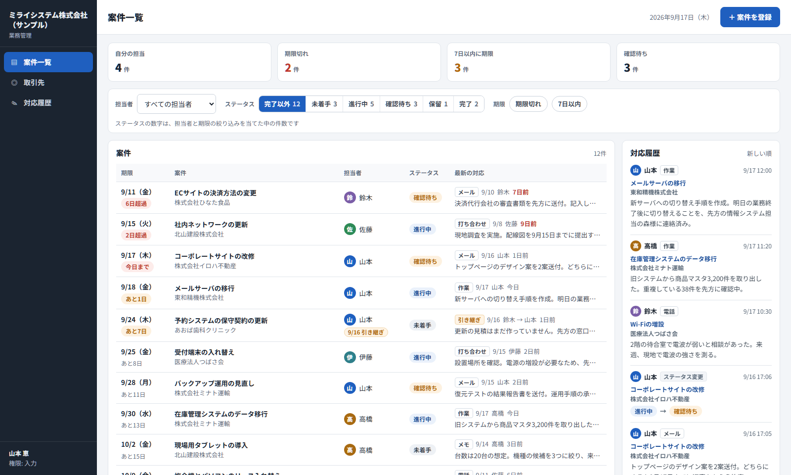

# task-case-manager

[](https://github.com/Mxhlix/task-case-manager/actions/workflows/test.yml)

English | [日本語](#日本語)

A business tool for managing a team's cases on a single screen.
Each case has an owner, a status, a due date and an activity history. Whenever the owner changes, a handover note is required.
It is a Google Apps Script (GAS) web app that uses a Google Sheets spreadsheet as its ledger.



## What it does

- Case list: see due date, owner, status and latest activity in one list. Counts for "mine", "overdue", "due within 7 days" and "awaiting review" appear at the top. Clicking one filters the list by that condition.
- Filters: owner, status (not started / in progress / awaiting review / on hold / done), overdue, due within 7 days.
- Case details: basic information and that case's activity history, newest first.
- Logging activity: pick a type (phone / email / meeting / work / note) and write what happened.
- Changing status: the before and after values are recorded in the activity history.
- Changing the due date: when you change it in the edit form, the before and after values are recorded in the activity history.
- Handover: enter a new owner and a handover note to reassign the case. The note is kept in the activity history, and the new owner can read it together with the past history.
- Client management: shows the number of open cases for each client.
- Activity history screen: view the history of all cases, filtered by author and type.
- Permissions: each user has view, edit or admin rights. A view-only user can only read, and every write is blocked. Users with edit or admin rights can reassign cases owned by others through the handover action.

## Design notes

- The owner and the status cannot be changed in the case edit form. They can only be changed through the "handover" and "change status" actions, so every change is recorded in the history.
- A handover cannot run with an empty handover note.
- The "latest activity" column in the list shows records written by people. Status and due date changes are not shown there, because the list already shows their current values in their own columns.
- Input validation runs on the server side (Code.gs), and all missing fields are returned at once. It does not rely on validation in the UI alone.
- Writes are processed one at a time with LockService, so simultaneous writes do not produce duplicate IDs.
- Input starting with `=` `+` `-` or `@` is saved with a leading `'`. This keeps the spreadsheet from treating it as a formula and stores it as plain text.
- All text shown on screen is escaped before it goes into the HTML.
- Dates and times use the time zone in `appsscript.json` (Asia/Tokyo).
- The ledger sheets are meant to be touched only through the app. There is no action that deletes cases or history.

## Verification

A small component (`harness/mock-gas.js`) imitates the GAS APIs (SpreadsheetApp, LockService, Session and so on) in Node.js, and it loads and runs `gas/Code.gs` as is.
The clock is fixed at 2026-09-17 13:00, and sample due dates are set as "N days from today", so the results are the same whenever you run it.

- `npm test`: 18 tests for Code.gs. They cover creating, editing, status, activity history, handover, clients, permissions, and handling of input that looks like a formula. Runs on Node.js alone.
- `npm run test:ui`: an end-to-end run that operates the real UI with Playwright. It goes through these steps in order: filtering, opening a case, being stopped on an empty record, logging a record, changing status, being stopped on a handover without a note, handing over, checking from the new owner's screen, creating a case, changing a due date, being unable to write with view-only rights, and the client and activity history screens. It reads counts and text from the screen to check them. Any single browser error makes it fail.

On GitHub Actions, `npm test` runs on Node.js 18 / 20 / 22, and `npm run test:ui` runs on Node.js 22 with headless Chromium.

## Getting started

Requires Node.js 18 or later.

```
npm install
npm test                          # tests for Code.gs
npx playwright install chromium   # first time only: install the browser used by the UI test
npm run test:ui                   # end-to-end UI check (saves a screenshot per step to harness/out/shots/)
npm run serve                     # open the UI at http://localhost:8795
```

`npm run serve` is a local server for running the UI without a Google environment. `--user` sets who opens it and `--now` sets today's date.

```
node harness/server.js --user kobayashi@example.jp --now 2026-09-17
```

To use it in a Google environment:

1. Create a new Google Sheets spreadsheet and open Apps Script from the Extensions menu.
2. Add the five files in `gas/` (`Code.gs`, `Index.html`, `app_js.html`, `style_css.html`, `appsscript.json`) with the same names.
3. For real use, set `CONFIG.DEMO_MODE` in `Code.gs` to `false`. While it is `true`, sample data is inserted when the ledger is empty.
4. Deploy it as a web app. `appsscript.json` is set so that only people in the same Google Workspace domain can open it (`access: DOMAIN`).
5. In the 「利用者」 (Users) sheet, enter each user's email address, display name and permission. While this sheet is empty, everyone can write with edit rights.

## Project layout

```
gas/
  Code.gs            server-side logic (ledger read/write, validation, permissions, sample data)
  Index.html         page skeleton
  app_js.html        UI behavior
  style_css.html     UI styling
  appsscript.json    GAS settings (time zone, web app access, permission scopes)
harness/
  mock-gas.js        imitation of the GAS APIs in Node.js
  load-code.js       loads and runs Code.gs
  run-tests.js       tests for Code.gs (npm test)
  server.js          local server for checking (npm run serve)
  ui-smoke.js        end-to-end UI check (npm run test:ui)
docs/                screenshots
```

## Not yet verified

- This repository has not verified behavior when deployed to a real Google spreadsheet and Apps Script. The tests run on top of components that imitate the GAS APIs.
- The imitation LockService only counts calls. Several people writing at the same time has not been tried.
- Display speed once cases and history grow to thousands of rows has not been measured.
- In the current implementation, edit and admin rights allow exactly the same actions. There is no action reserved for admins.
- The UI was checked in Chromium (Playwright) only.

## License

MIT. See [LICENSE](LICENSE).

---

## 日本語

チームで抱えている案件を、1つの画面で管理する業務管理ツールです。
案件ごとに担当者・ステータス・期限・対応履歴を持ち、担当者を替えるときは申し送りを必ず残します。
Google スプレッドシートを台帳にした Google Apps Script（GAS）の Web アプリです。


### できること

- 案件一覧：期限・担当者・ステータス・最新の対応を一覧で見る。「自分の担当」「期限切れ」「7日以内に期限」「確認待ち」の件数を上に出し、押すとその条件で絞り込む。
- 絞り込み：担当者、ステータス（未着手 / 進行中 / 確認待ち / 保留 / 完了）、期限切れ、7日以内。
- 案件の詳細：基本情報と、その案件の対応履歴を新しい順に見る。
- 対応の記録：種別（電話 / メール / 打ち合わせ / 作業 / メモ）を選んで内容を書く。
- ステータスの切り替え：変更前と変更後が対応履歴に残る。
- 期限の変更：編集で期限を変えると、変更前と変更後が対応履歴に残る。
- 引き継ぎ：新しい担当者と申し送りを入れて担当を替える。申し送りは対応履歴に残り、新しい担当者は過去の履歴と一緒に読める。
- 取引先の管理：取引先ごとに、完了していない案件の数を出す。
- 対応履歴の画面：全案件の履歴を、記入者と種別で絞り込んで見る。
- 権限：利用者ごとに 閲覧 / 入力 / 管理 を持つ。閲覧の人は読むだけで、書き込みはすべて止まる。入力か管理の権限があれば、自分以外が担当する案件も引き継ぎの操作で付け替えられる。

### 設計で気をつけたこと

- 担当者とステータスは、案件の編集画面では変えられないようにしました。変えるときは「引き継ぎ」と「ステータスの切り替え」の操作を通り、必ず履歴に残ります。
- 引き継ぎは、申し送りが空だと実行できません。
- 一覧の「最新の対応」には、人が書いた記録を出します。ステータス変更や期限変更は一覧の列に今の値が出ているので、そこには出しません。
- 入力のチェックはサーバ側（Code.gs）で行い、足りない項目はまとめて返します。画面側のチェックだけに頼りません。
- 書き込みは LockService で順番に処理し、同時に書いても番号が重ならないようにしています。
- `=` `+` `-` `@` で始まる入力は、先頭に `'` を付けて保存します。スプレッドシートに数式として解釈させず、文字のまま残すためです。
- 画面に出す文字はすべてエスケープしてから HTML に入れます。
- 日付と時刻は、`appsscript.json` のタイムゾーン（Asia/Tokyo）で扱います。
- 台帳のシートは画面からだけ触る前提です。案件と履歴を消す操作は用意していません。

### 検証

GAS の API（SpreadsheetApp、LockService、Session など）を Node.js で真似る小さな部品（`harness/mock-gas.js`）を作り、`gas/Code.gs` をそのまま読み込んで動かしています。
日時は 2026-09-17 13:00 に固定し、サンプルの期限は「今日から何日」で入れているので、いつ動かしても同じ結果になります。

- `npm test`：Code.gs のテスト18項目。登録・編集・ステータス・対応履歴・引き継ぎ・取引先・権限・数式に見える入力の扱いを確かめます。Node.js だけで動きます。
- `npm run test:ui`：Playwright で画面を実際に操作する通しの確認です。絞り込み、案件を開く、空の記録で止まる、記録する、ステータスを変える、申し送り無しで止まる、引き継ぐ、引き継いだ人の画面で確かめる、案件の登録、期限の変更、閲覧の権限では書けない、取引先と対応履歴の画面、の順に進み、件数と文言を画面から読んで確かめます。ブラウザのエラーが1つでも出たら失敗にします。

GitHub Actions では、`npm test` を Node.js 18 / 20 / 22 で、`npm run test:ui` を Node.js 22 と headless の Chromium で動かしています。

### 動かし方

Node.js 18 以上が必要です。

```
npm install
npm test                          # Code.gs のテスト
npx playwright install chromium   # 初回だけ。画面のテストに使うブラウザを入れる
npm run test:ui                   # 画面の通しの確認（場面ごとの画像を harness/out/shots/ に保存）
npm run serve                     # http://localhost:8795 で画面を開く
```

`npm run serve` は、Google の環境なしで画面を動かすためのローカルサーバです。`--user` で開く人を、`--now` で今日の日付を指定できます。

```
node harness/server.js --user kobayashi@example.jp --now 2026-09-17
```

Google 環境で使うときの流れは次のとおりです。

1. Google スプレッドシートを新しく作り、拡張機能から Apps Script を開く。
2. `gas/` の5つのファイル（`Code.gs`、`Index.html`、`app_js.html`、`style_css.html`、`appsscript.json`）を同じ名前で置く。
3. 実運用では `Code.gs` の `CONFIG.DEMO_MODE` を `false` にする。`true` のままだと、台帳が空のときにサンプルデータが入る。
4. Web アプリとしてデプロイする。`appsscript.json` は、同じ Google Workspace のドメインの人だけが開ける設定（`access: DOMAIN`）にしています。
5. 「利用者」シートに、使う人のメールアドレス・表示名・権限を書く。このシートが空の間は、全員が入力の権限で書き込めます。

### フォルダ構成

```
gas/
  Code.gs            サーバ側の処理（台帳の読み書き、入力チェック、権限、サンプルデータ）
  Index.html         画面の骨組み
  app_js.html        画面の動き
  style_css.html     画面の見た目
  appsscript.json    GAS の設定（タイムゾーン、Web アプリの公開範囲、権限の範囲）
harness/
  mock-gas.js        GAS の API を Node.js で真似る部品
  load-code.js       Code.gs を読み込んで動かす
  run-tests.js       Code.gs のテスト（npm test）
  server.js          ローカル確認用サーバ（npm run serve）
  ui-smoke.js        画面の通しの確認（npm run test:ui）
docs/                画面写真
```

### まだ確かめていないこと

- 本物の Google スプレッドシートと Apps Script にデプロイした状態での動作は、このリポジトリでは確かめていません。テストは、GAS の API を真似た部品の上で動かしています。
- 真似た部品の LockService は数を数えるだけです。複数の人が同時に書き込む状況は試していません。
- 案件や履歴が数千件に増えたときの表示の速さは測っていません。
- 今の実装では、入力と管理の権限にできることの差はありません。管理だけに許す操作は作っていません。
- 画面の確認は Chromium（Playwright）だけで行っています。

### ライセンス

MIT です。[LICENSE](LICENSE) を見てください。
